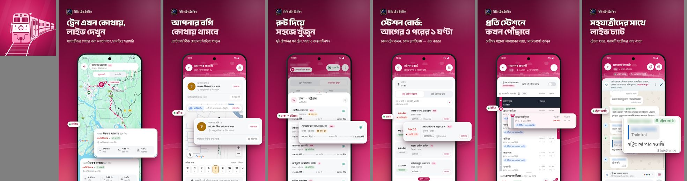
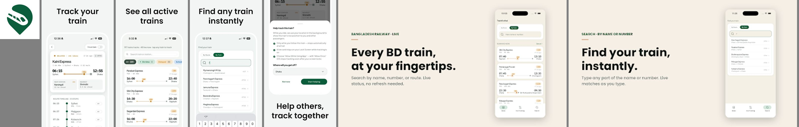
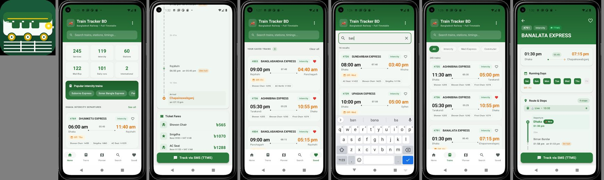
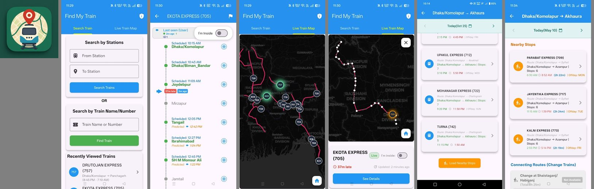
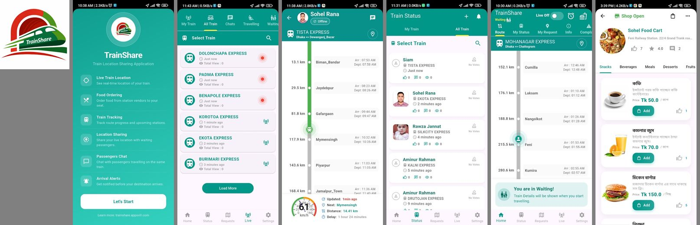
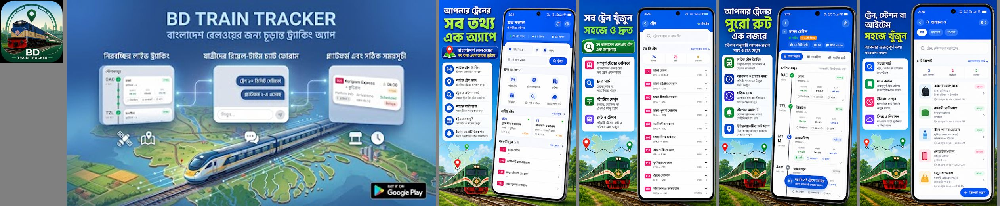
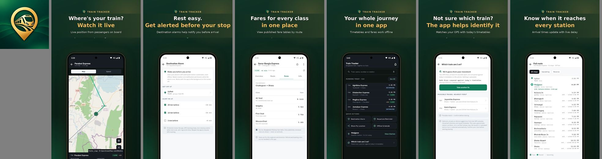
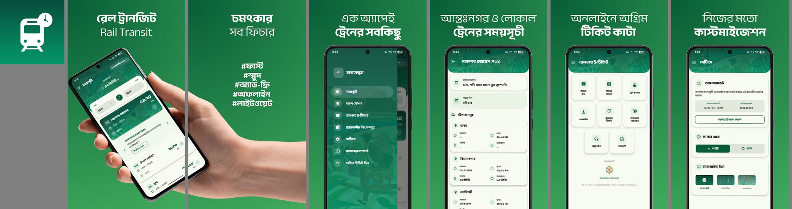
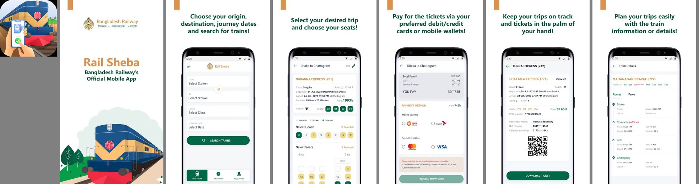

# বাংলাদেশের ট্রেন ট্র্যাকিং অ্যাপ: প্রতিযোগী বিশ্লেষণ

> তথ্য সংগ্রহ: ১৪ অক্টোবর ২০২৬, Google Play Store (দেশ: বাংলাদেশ) আর অ্যাপগুলোর নিজস্ব ওয়েবসাইট থেকে।
> প্রতিটা অ্যাপের স্ক্রিনশট [screenshots/](screenshots/) ফোল্ডারে আছে।
> রঙের hex কোড স্ক্রিনশট থেকে মাপা, তাই আসল কোডের সাথে একটু পার্থক্য থাকতে পারে।

---

## ১. এক নজরে মূল কথা

1. **সব ট্র্যাকিং অ্যাপ একই পদ্ধতিতে চলে।** ট্রেনে থাকা যাত্রী "আমি ট্রেনে আছি" চাপলে তার ফোনের GPS দিয়ে ট্রেনের অবস্থান দেখানো হয়। সরকারি কোনো লাইভ ডেটা নেই।
2. **সবার সবচেয়ে বড় দুর্বলতা একই।** কোনো ট্রেনে কেউ শেয়ার না করলে সেই ট্রেনের লাইভ ডেটা থাকে না। বেশিরভাগ খারাপ রিভিউ এই কারণেই: "লোকেশন দেখায় না", "ভুল লোকেশন"।
3. **বাজারে দুটো অ্যাপ এগিয়ে।** BD Train Tracking আর TrainKothai, দুটোরই ১ লাখের বেশি ডাউনলোড আর রেটিং ৪.৫-এর উপরে।
4. **সবচেয়ে ভালো ফিচার সেট বানিয়েছে Bitnex Labs-এর "Train Tracker BD: Live Train"।** কিন্তু ডাউনলোড মাত্র ৫০০+। মানে শুধু ভালো ফিচার যথেষ্ট না, ইউজার আনতেও পারতে হবে।
5. **সরকারি একমাত্র উৎস TTMS SMS।** `TR <ট্রেন নম্বর>` লিখে **16318**-এ পাঠাতে হয়, প্রতি SMS-এ প্রায় ৳৫ কাটে। মাত্র দুটো অ্যাপ এটা নিজেদের অ্যাপে জুড়েছে।
6. **রঙের দিক থেকে সবুজ সবচেয়ে বেশি ব্যবহার হচ্ছে।** ৯টা অ্যাপের মধ্যে ৫টা সবুজ (বাংলাদেশ রেলওয়ের রঙের প্রভাব)। আলাদা দেখাতে চাইলে অন্য রঙ নেওয়া ভালো।

---

## ২. বাজারের অবস্থা

| # | অ্যাপ | ডেভেলপার | ডাউনলোড | রেটিং (রিভিউ) | শেষ আপডেট | ধরন |
|---|---|---|---|---|---|---|
| 1 | **BD Train Tracking** | Gatishil Ventures | ১ লাখ+ | ৪.৬ (৬.৯ হাজার) | ১৩ অক্টো ২০২৬ | লাইভ ট্র্যাকিং |
| 2 | **TrainKothai** | FoodOS (theflutterway) | ১ লাখ+ | ৪.৭ (৩.৫১ হাজার) | ১৪ অক্টো ২০২৬ | লাইভ ট্র্যাকিং + ওয়েবসাইট |
| 3 | **Train Tracker BD** | Red Green Apps | ১০ হাজার+ | ৪.৫ (১৩৪) | ৫ অক্টো ২০২৬ | ট্র্যাকিং + সময়সূচী + ভাড়া |
| 4 | **Find My Train: Bangladesh** | NITS22 | ১০ হাজার+ | ৩.৯ (৪২) | ৫ সেপ্টে ২০২৬ | লাইভ ট্র্যাকিং |
| 5 | **TrainShare** | AppsVill | ১০ হাজার+ | ৪.০ (৪০) | ৮ অক্টো ২০২৬ | ট্র্যাকিং + চ্যাট + খাবার |
| 6 | **BD Train Tracker Live** | Hexora | ৫ হাজার+ | ৩.০ (১৩) | ৯ সেপ্টে ২০২৬ | ট্রেন + মেট্রো রেল |
| 7 | **Train Tracker BD: Live Train** | Bitnex Labs | ৫০০+ | রেটিং নেই | ১ অক্টো ২০২৬ | লাইভ ট্র্যাকিং |
| 8 | **Rail Transit (রেল ট্রানজিট)** | Faisal F Rafat | ১০ হাজার+ | ৪.২ (২০৮) | ২৩ আগ ২০২৬ | শুধু সময়সূচী |
| 9 | **Rail Sheba** (সরকারি) | Bangladesh Railway / Shohoz | ৫০ লাখ+ | ৪.২ (১৭.৪ হাজার) | ১২ সেপ্টে ২০২৫ | শুধু টিকেট |
| 10 | **Railgari App** | abdulazizmia | ১০ হাজার+ | ৪.৪ | ১৯ মার্চ ২০২৬ | লাইভ ট্র্যাকিং + সময়সূচী + টিকেট তথ্য + চ্যাট |
| 11 | **Train Koi** | nurcreates | ৫+ | — | ১৩ অক্টো ২০২৬ | লাইভ ট্র্যাকিং + চ্যাট (একদম নতুন) |

> ১০ আর ১১ নম্বর অ্যাপ নাম খোঁজার সময় পাওয়া গেছে (১৪ অক্টো ২০২৬), এদের বিস্তারিত বিশ্লেষণ এখনো করা হয়নি।

---

## ৩. প্রতিটা অ্যাপের বিস্তারিত

### ৩.১ BD Train Tracking (Gatishil Ventures) 🥇 সবচেয়ে বেশি রিভিউ

**মূল আইডিয়া:** "কমিউনিটি-পাওয়ার্ড রেল সঙ্গী"। যাত্রীরা লোকেশন শেয়ার করে, সবাই দেখে।

**ফিচার:**
- যাত্রীদের শেয়ার করা লাইভ লোকেশন, Google Maps-এ লাল রুট লাইন দিয়ে
- **"আমি ট্রেনে আছি"** বাটন। এটা দিয়ে পরিবারের সাথেও লোকেশন শেয়ার করা যায়
- **বগির অবস্থান:** "আপনার বগি কোথায় থামবে", মানে প্ল্যাটফর্মের কোন জায়গায় দাঁড়াতে হবে। **এটা অন্য কোনো অ্যাপে নেই।**
- রুট দিয়ে খোঁজা: দুই স্টেশনের মধ্যে সব ট্রেন, সময় আর বন্ধের দিন
- **স্টেশন বোর্ড:** আগের ও পরের ১ ঘণ্টার ট্রেন, কোন প্ল্যাটফর্মে আসবে
- প্রতি স্টেশনে কখন পৌঁছাবে, দেরি হিসাব করে
- যাত্রীদের লাইভ চ্যাট ("হাটুভাঙ্গা পার হয়েছে, ৫ মিনিট আগে")
- আনুমানিক গতি
- **আয়ের উৎস:** অ্যাপের ভেতরে Shop (ট্রাভেল গিয়ার বিক্রি), সাথে অল্প বিজ্ঞাপন

**ডিজাইন ও রঙ:**
- প্রাইমারি রঙ **ম্যাজেন্টা/মেরুন** গ্রেডিয়েন্ট: `#780838` → `#981048` → `#A81050`, গাঢ় অংশে `#580828`
- সাদা কার্ড, গোল কোণা, পিল আকারের ট্যাগ, নিচ থেকে ওঠা bottom sheet
- Play Store স্ক্রিনশটে বড় বাংলা হেডলাইন ("ট্রেন এখন কোথায়, লাইভ দেখুন")। পুরো অ্যাপ বাংলা-প্রথম।
- আইকন: গোলাপি ট্রেন, রেললাইনের উপর
- বাজারে একমাত্র ম্যাজেন্টা অ্যাপ, তাই সহজে চোখে পড়ে আর আলাদা করে চেনা যায়

**রিভিউ থেকে শিক্ষা:**
- ❌ "লোকেশন শেয়ার ডিফল্টভাবে চালু থাকে না, যাত্রীরা চালু করতে ভুলে যায়, তাই ট্রেন দেখা যায় না"
- ❌ "লোকেশন সাথে সাথে আপডেট হয় না, প্রতিটা ট্রেনে একজন active GPS লাগবে"
- ✅ "বিজ্ঞাপন কম", "লোকেশন ছাড়াও অনেক দরকারি তথ্য আছে"

---

### ৩.২ TrainKothai 🥇 সবচেয়ে বেশি রেটিং

**মূল আইডিয়া:** SMS-এ প্রতিবার ৳৫ খরচ না করে ফ্রিতে ট্রেনের লোকেশন দেখা। অ্যাকাউন্ট খুলতে হয় না। অ্যাপের পাশাপাশি ওয়েবসাইটও আছে ([trainkothai.com](https://trainkothai.com/))।

**ফিচার:**
- লাইভ লোকেশন, **দেরি, গতি**, পরের স্টেশনের ETA
- "I'm on the train" চাপলে **সিস্টেম যাচাই করে ইউজার আসলেই ঐ ট্রেনে আছে কিনা**, তারপর ডেটা নেয়
- শেয়ার শুরুর আগে জিজ্ঞেস করে "কোথায় নামবেন?", গন্তব্যে পৌঁছালে নিজে থেকে বন্ধ হয়
- **লক স্ক্রিনে লাইভ কার্ড** (iOS Live Activity)
- সক্রিয় ট্রেনের তালিকা, ফিল্টারসহ: All / On time / Delayed / Scheduled ("197 tracks · 48 live now")
- রুট টাইমলাইন (১৩ স্টপ), রুট বা ট্রেন দিয়ে খোঁজা
- ওয়েবসাইটে Live Board, স্টেশন বোর্ড, জার্নি অ্যালার্ম
- **গত ১৪ দিনের দেরির হিস্টরি**
- অফলাইন সময়সূচী, বাংলা ভার্সন
- ব্যস্ত সময়ে একসাথে ৫০টার বেশি ট্রেন লাইভ থাকে

**ডিজাইন ও রঙ:**
- **মিনিমাল, প্রিমিয়াম লুক।** হালকা অফ-হোয়াইট বা বেইজ ব্যাকগ্রাউন্ড (`#F0EFE9`, `#E0C8B0`)
- প্রাইমারি **গাঢ় বনসবুজ** `#005030` / `#085838`
- দেরি বোঝাতে কমলা ব্যাজ ("+5h 12m")
- ট্রেন কার্ড: বাঁয়ে ছাড়ার সময়, ডানে পৌঁছানোর সময়, মাঝে প্রোগ্রেস বারে ট্রেনের অবস্থান। এটা দেখতে খুব পরিষ্কার।
- টাইপোগ্রাফি পরিষ্কার, iOS-ঘেঁষা স্টাইল, অনেক খালি জায়গা
- আইকন: সবুজ ম্যাপ পিনের ভেতরে ট্রেন

**রিভিউ থেকে শিক্ষা (ইউজাররা যা চাইছে):**
- 💡 "সাপ্তাহিক হিস্টরি দিন, যাতে বোঝা যায় কোন ট্রেন সবসময় লেট করে"
- 💡 "একটা ট্রেন **পিন** করে রাখতে চাই, হোমপেজে আর নোটিফিকেশনে যেন সবসময় দেখায়"
- 💡 "একটা **স্টেশন পিন** করলে ঐদিন সেখান দিয়ে যত ট্রেন যাবে সবগুলোর তালিকা দেখাক"
- 💡 "গন্তব্যে পৌঁছানোর পর অ্যাপ পরিষ্কার করে জানায় না যে যাত্রা শেষ"

---

### ৩.৩ Train Tracker BD (Red Green Apps): সবচেয়ে বেশি তথ্য

**মূল আইডিয়া:** লাইভ ট্র্যাকিং, পুরো সময়সূচী, ভাড়া আর জার্নি প্ল্যানার, সব এক অ্যাপে।

**ফিচার:**
- যাত্রীদের GPS আর **TTMS SMS**, দুই উৎস থেকেই অবস্থান
- **"Position right?"** বাটন: এক ট্যাপে লোকেশন ঠিক বা ভুল জানানো যায়
- **প্রতিটা আপডেট কত পুরনো আর কোথা থেকে এসেছে** (যাত্রীর GPS নাকি SMS), তা দেখায়
- **লাইভ ডেটা না থাকলে সময়সূচী থেকে আনুমানিক অবস্থান দেখায়**
- এক ট্যাপে TTMS: SMS অ্যাপ খুলে `TR <নম্বর>` লেখা অবস্থায় তৈরি থাকে
- ২৪৫+ ট্রেন, চলার দিন আর সাপ্তাহিক বন্ধের দিন
- **ক্লাস অনুযায়ী ভাড়া** (শোভন চেয়ার, স্নিগ্ধা, AC; VAT সহ)
- জার্নি প্ল্যানার। বাংলা আর ইংরেজি দুই বানানেই স্টেশন খোঁজা যায়।
- **অফলাইন রেল নেটওয়ার্ক ম্যাপ:** ২৩৭ স্টেশন, ৩৭৯ রুট
- পুরো অ্যাপ বাংলায়, পছন্দের ট্রেন, রিমাইন্ডার, **হোম স্ক্রিন উইজেট**, ডার্ক মোড
- লগইন ঐচ্ছিক, অ্যাপের ভেতরে "Report correction"
- আয়: AdMob বিজ্ঞাপন

**ডিজাইন ও রঙ:**
- Material 3। হেডার **গাঢ় সবুজ** `#206830`, পৌঁছানোর সময় **কমলা**, বন্ধের দিনের জন্য হলুদ ট্যাগ
- হোমে পরিসংখ্যানের টাইল (২৪৫ সার্ভিস, ১১৯ আন্তঃনগর, ৬০ স্টেশন...)
- নিচে ৫টা ট্যাব: Home, Trains, Planner, Search, Saved
- নিচে বড় সবুজ বাটন "Track via SMS (TTMS)"
- ছাড়ার দিনগুলো চিপ আকারে (Sat, Sun, Mon...)

**রিভিউ থেকে শিক্ষা:**
- ❌ "লোকেশন পুরো ভুল, ট্রেন ভুল জায়গায় দেখায়"
- ❌ "রিয়েল টাইম লোকেশন দেখায় না"
- এখানে শিক্ষা হলো: আনুমানিক অবস্থান দেখালে সেটা যে **আনুমানিক**, তা খুব স্পষ্ট করে বলতে হবে। না হলে ইউজার ভাবে অ্যাপ ভুল তথ্য দিচ্ছে।

---

### ৩.৪ Find My Train: Bangladesh (NITS22)

**মূল আইডিয়া:** হালকা, Flutter দিয়ে বানানো, কমিউনিটি-ভিত্তিক ট্র্যাকার।

**ফিচার:**
- স্টেশন দিয়ে বা ট্রেনের নাম/নম্বর দিয়ে খোঁজা, সম্প্রতি দেখা ট্রেনের তালিকা
- "I'm Inside" টগল
- টাইমলাইনে **নির্ধারিত সময় আর অনুমিত সময় পাশাপাশি**, সাথে "37m late" ব্যাজ
- "Last seen (User) 2m ago", মানে শেষ আপডেট কখন এসেছে
- **লাইভ ট্রেন ম্যাপ:** অন্ধকার ম্যাপে বাংলাদেশের সব ট্রেন নম্বরসহ গোল চিহ্নে
- কাছাকাছি স্টপ, **ট্রেন বদলে যাওয়ার রুট** ("Change at Shaistaganj")
- তারিখ বেছে নেওয়া যায়, অফলাইন ডাউনলোড

**ডিজাইন ও রঙ:**
- সাধারণ Material স্টাইল। নীল অ্যাপবার `#2090E8`, সবুজ বাটন `#48B050`, কমলা আইকন `#F89000`
- ডার্ক ম্যাপে গোলাপি রেললাইন সুন্দর দেখায়, কিন্তু বাকি UI পুরনো ধাঁচের
- ডিজাইন সাধারণ, রেটিংও কম (৩.৯)

**রিভিউ থেকে শিক্ষা:**
- ❌ "ঠিক লোকেশন দেয় না"
- ✅ "প্রতিদিন ব্যবহার করি"। মানে নিয়মিত কমিউটাররা এই অ্যাপগুলোর মূল ইউজার।

---

### ৩.৫ TrainShare (AppsVill)

**মূল আইডিয়া:** ট্রেন যাত্রার জন্য "সুপার অ্যাপ": ট্র্যাকিং, চ্যাট, অ্যালার্ম আর **ট্রেনে খাবার অর্ডার**।

**ফিচার:**
- লাইভ ট্র্যাকিং, স্টেশন ধরে ধরে অগ্রগতি
- **স্পিডোমিটার গেজ** (৬১ কিমি/ঘণ্টা), দূরত্ব, দেরি, পরের স্টেশন
- গন্তব্য অ্যালার্ম, ব্যাকগ্রাউন্ড অ্যালার্ট
- যাত্রী চ্যাট, প্রোফাইল, ভোট, প্রতিটা ট্রেন কতজন দেখছে
- **"Waiting" মোড:** স্টেশনে অপেক্ষারত যাত্রীও লোকেশন শেয়ার করতে পারে
- **ফুড অর্ডার:** স্টেশনের দোকান থেকে সিটে খাবার পৌঁছানো (কফি ৳৫০, বার্গার ৳১৫০)

**ডিজাইন ও রঙ:**
- **টিল** `#009088` / `#28C0B0`, লোগো লাল-সবুজ
- উপরে অনেকগুলো ট্যাব, অনেক তথ্য ঠাসা, একটু অগোছালো
- স্পিডোমিটার আইডিয়াটা মজার

**শিক্ষা:** অনেক ফিচার আছে কিন্তু মূল ট্র্যাকিং দুর্বল হলে লাভ নেই। খাবার অর্ডার পরে আয়ের উৎস হতে পারে, তবে MVP-তে না রাখাই ভালো।

---

### ৩.৬ BD Train Tracker Live (Hexora)

**মূল আইডিয়া:** বাংলাদেশ রেলওয়ের সাথে **ঢাকা মেট্রো রেল (MRT)** ট্র্যাকিংও।

**ফিচার:**
- লাইভ ম্যাপ, দেরি, ETA, ট্রেন আর মেট্রো খোঁজা
- প্রতিটা যাত্রার জন্য আলাদা চ্যাট রুম
- **ব্যাকগ্রাউন্ড GPS, যাত্রা শেষে নিজে থেকে বন্ধ হয়**
- বাংলা ইন্টারফেস, **বাংলা সংখ্যা**
- নোটিফিকেশন "শীঘ্রই আসছে"

**ডিজাইন ও রঙ:**
- উজ্জ্বল **রয়্যাল ব্লু** `#0050F0`, সাথে `#285088`
- Play Store স্ক্রিনশটে বাংলা হেডলাইন আর বাংলাদেশ রেলওয়ের সবুজ ট্রেনের ছবি। মার্কেটিং ভালো।

**রিভিউ থেকে শিক্ষা:**
- ❌ "don't work", "কাজ করে না কয়েকবার চেষ্টা করছি", "চলছে না কেন?"
- **বড় শিক্ষা:** প্রথম ইমপ্রেশন খারাপ হলে রেটিং ৩.০-তে নেমে যায়। লঞ্চের আগে অ্যাপ স্থিতিশীল হতে হবে, আর ডেটা না থাকলেও একটা কাজের কিছু দেখাতে হবে।

---

### ৩.৭ Train Tracker BD: Live Train (Bitnex Labs) ⭐ ফিচার আর চিন্তার দিক থেকে সেরা

**মূল আইডিয়া:** প্রাইভেসি-প্রথম, বিজ্ঞাপন নেই, অ্যাকাউন্ট নেই। ছোট ছোট সমস্যাও গভীরভাবে ভেবে সমাধান করা।

**ফিচার (এখান থেকে শেখার অনেক কিছু আছে):**
- **কয়েকজনের GPS মিলিয়ে একটা অবস্থান দেখায়**, তাই কোনো একজনের ফোন আলাদা করে চেনা যায় না
- **গন্তব্য অ্যালার্ম:** ফোন সাইলেন্ট থাকলেও আসল অ্যালার্মের মতো বাজে, স্টেশনের ২০/১০/৫ কিমি আগে। Android অ্যাপ বন্ধ করে দিলে প্রত্যাশিত সময়ে **ব্যাকআপ অ্যালার্ম** বাজে।
- **লাইভ বোর্ড:** এই মুহূর্তে চলা সব ট্রেন, ফিল্টার: live, on-time, delayed। লাইভ না থাকলে "ESTIMATED" লেবেল।
- প্রতিটা স্টপে বাংলা নাম, দূরত্ব, থামার সময়, আর **লাইভ দেরি ধরে হিসাব করা ETA**
- দুই স্টেশন বেছে নিলে আজকের সব ট্রেন, যাত্রার সময়, স্টপ সংখ্যা আর সিট ক্লাস
- সব ক্লাসের ভাড়া
- **ইন্টারনেট না থাকলেও চলে:** সময়সূচী ফোনে রাখা। ডেটা একেবারে না থাকলে SMS দিয়ে ট্র্যাক।
- **"কোন ট্রেনে আছি?"** দুটো GPS রিডিং আজকের সময়সূচীর সাথে মিলিয়ে ইউজারের ট্রেনটা কোনটা হতে পারে, তা বলে দেয়
- ছাড়ার আগে রিমাইন্ডার
- **পরিবারকে লাইভ লিংক পাঠানো যায়, লিংক কতক্ষণ চলবে তা ঠিক করে দেওয়া যায়**
- গত ৭ দিনের দেরির হিস্টরি
- ট্রেন, স্টেশন আর রুট সেভ করা যায়, Light/Dark/System থিম, বাংলা ও ইংরেজি

**ডিজাইন ও রঙ:**
- **প্রিমিয়াম ডার্ক গ্রিন আর গোল্ড।** ব্যাকগ্রাউন্ড `#183020` / `#103020`, অ্যাকসেন্ট `#087858`, আইকন সোনালি
- ম্যাপ OpenStreetMap (flutter_map), তাই খরচ নেই
- ভেতরের স্ক্রিন সাদা আর পরিষ্কার, "+LIVE" সবুজ ব্যাজ
- স্টোর স্ক্রিনশটে প্রশ্ন আর উত্তরের ধরনে লেখা ("Where's your train? Watch it live")

**শিক্ষা:** সবচেয়ে ভাবনাচিন্তা করে বানানো অ্যাপ, কিন্তু ডাউনলোড মাত্র ৫০০+। ক্রাউডসোর্সড অ্যাপে ইউজার কম থাকলে লাইভ ডেটাও কম থাকে, ফলে নতুন ইউজারও আসে না। তাই **শুরু থেকেই মার্কেটিং আর ইউজার আনার পরিকল্পনা** করতে হবে।

---

### ৩.৮ Rail Transit / রেল ট্রানজিট (Faisal F Rafat)

**মূল আইডিয়া:** নরসিংদীর কমিউটারদের জন্য শুরু, এখন সারা দেশের **অফলাইন সময়সূচী**। লাইভ ট্র্যাকিং নেই।

**ফিচার:**
- অফলাইন সময়সূচী, স্টপেজ, বন্ধের দিন
- From-To স্টেশন দিয়ে খোঁজা
- রেলওয়ে ই-টিকেট হাব (টিকেট কেনা, হিস্টরি, যাচাই)
- স্টেশন ম্যাপ
- **থিম বদলানো যায়:** Steam Engine, Islamic, Abstract ব্যাকগ্রাউন্ড
- বিজ্ঞাপন নেই, হালকা, অপ্রয়োজনীয় পারমিশন চায় না

**ডিজাইন ও রঙ:**
- নিজেরা বলে "Premium Emerald Design"। **এমারাল্ড সবুজ** `#208048` / `#106838`
- **Anek Bangla ফন্ট**, বাংলা পড়তে খুব আরাম
- বাংলা-প্রথম UI, হাতে ফোন ধরা ছবি দিয়ে স্টোর স্ক্রিনশট
- লাইট আর ডার্ক মোড

**রিভিউ থেকে শিক্ষা:** লোকাল কমিউনিটি (নরসিংদী) থেকে শুরু করলে বিশ্বস্ত ইউজার পাওয়া যায়। তারা নিজেরাই নির্দিষ্ট স্টেশন যোগ করার অনুরোধ করে ("তেজগাঁও স্টেশন যোগ করুন")।

---

### ৩.৯ Rail Sheba (সরকারি: বাংলাদেশ রেলওয়ে / Shohoz)

**মূল আইডিয়া:** শুধু **টিকেট কেনা**। ট্র্যাকিং নেই।

**ফিচার:** স্টেশন, ক্লাস আর তারিখ দিয়ে খোঁজা, সিট বাছাই, bKash/Nagad/কার্ডে পেমেন্ট, QR কোডসহ ই-টিকেট, ট্রেনের রুট আর চলার দিন।

**ডিজাইন ও রঙ:** বাংলাদেশ রেলওয়ের **সবুজ** `#006840`, সাথে সোনালি/কমলা `#F8C070`, ইলাস্ট্রেশনে রেলের লাল-নীল ট্রেন।

**রিভিউ থেকে শিক্ষা:**
- ❌ বারবার ক্র্যাশ, রেজিস্ট্রেশন আর SIM যাচাইয়ে সমস্যা
- ❌ টিকেট "আছে" দেখায় কিন্তু কিনতে গেলে পাওয়া যায় না
- 💡 একাধিক টিকেট থেকে একটা বাতিল করার সুবিধা চাইছে
- ৫০ লাখ+ ইউজার আছে, কিন্তু এক বছরের বেশি আপডেট হয়নি। আমাদের অ্যাপ টিকেট বেচবে না, শুধু Rail Sheba বা eticket.railway.gov.bd-তে **লিংক** দেবে।

---

## ৪. ফিচার তুলনা

✅ = আছে, — = নেই বা উল্লেখ নেই

| ফিচার | BD Train Tracking | TrainKothai | Train Tracker BD (RG) | Find My Train | TrainShare | Hexora | Bitnex | Rail Transit | Rail Sheba |
|---|---|---|---|---|---|---|---|---|---|
| যাত্রীদের GPS দিয়ে লাইভ লোকেশন | ✅ | ✅ | ✅ | ✅ | ✅ | ✅ | ✅ | — | — |
| লাইভ না থাকলে আনুমানিক অবস্থান | — | — | ✅ | — | — | — | ✅ | — | — |
| TTMS SMS (16318) যুক্ত | — | — | ✅ | — | — | — | ✅ | — | — |
| শেয়ারকারী আসলেই ট্রেনে কিনা যাচাই | — | ✅ | ✅ (Position right?) | — | — | — | ✅ (কোন ট্রেনে আছি?) | — | — |
| দেরি আর ETA | ✅ | ✅ | ✅ | ✅ | ✅ | ✅ | ✅ | — | — |
| গতি দেখানো | ✅ | ✅ | — | — | ✅ | — | — | — | — |
| দেরির হিস্টরি | — | ✅ (১৪ দিন) | — | — | — | — | ✅ (৭ দিন) | — | — |
| গন্তব্য অ্যালার্ম | — | ✅ | — | — | ✅ | শীঘ্রই | ✅ (সাইলেন্টেও বাজে) | — | — |
| স্টেশন বোর্ড বা লাইভ বোর্ড | ✅ | ✅ | ✅ | — | — | — | ✅ | — | — |
| From-To রুট খোঁজা | ✅ | ✅ | ✅ | ✅ | — | ✅ | ✅ | ✅ | ✅ |
| ভাড়া | — | — | ✅ | — | — | — | ✅ | — | ✅ |
| অফলাইন সময়সূচী | — | ✅ | ✅ | ✅ | — | — | ✅ | ✅ | — |
| যাত্রী চ্যাট | ✅ | — | — | — | ✅ | ✅ | — | — | — |
| বগির অবস্থান | ✅ | — | — | — | — | — | — | — | — |
| পরিবারকে লোকেশন বা লিংক পাঠানো | ✅ | — | — | — | — | — | ✅ | — | — |
| উইজেট বা লক স্ক্রিন কার্ড | — | ✅ | ✅ | — | — | — | — | — | — |
| বাংলা ভাষা | ✅ | ✅ | ✅ | — | — | ✅ | ✅ | ✅ | — |
| ডার্ক মোড | — | — | ✅ | — | — | — | ✅ | ✅ | — |
| অ্যাকাউন্ট ছাড়া ব্যবহার | — | ✅ | ✅ | — | — | — | ✅ | ✅ | — |
| ওয়েবসাইট | — | ✅ | — | — | — | — | — | — | ✅ |
| মেট্রো রেল | — | — | — | — | — | ✅ | — | — | — |
| টিকেট কেনা | — | — | — | — | — | — | — | ✅ | ✅ |
| বিজ্ঞাপনমুক্ত | — | — | — | — | — | — | ✅ | ✅ | ✅ |

---

## ৫. ডিজাইন বিশ্লেষণ

### ৫.১ রঙের অবস্থা

| রঙ | কোন অ্যাপ |
|---|---|
| 🟢 সবুজ | TrainKothai `#005030`, Train Tracker BD `#206830`, Bitnex `#183020` + সোনালি, Rail Transit `#208048`, Rail Sheba `#006840` |
| 🔴 ম্যাজেন্টা/মেরুন | BD Train Tracking `#981048` |
| 🔵 নীল | Find My Train `#2090E8`, Hexora `#0050F0` |
| 🩵 টিল | TrainShare `#009088` |

**সিদ্ধান্তের জন্য:** সবুজ নিলে মানুষ সহজে "রেলওয়ে" বলে চিনবে, কিন্তু ৫টা অ্যাপের ভিড়ে আলাদা করে চোখে পড়বে না। সবুজ ছাড়া অন্য রঙ নিলে নিজস্ব পরিচয় তৈরি হবে। এখনো কেউ নেয়নি এমন রঙ: **গাঢ় ইন্ডিগো, কমলা বা অ্যাম্বার, রেলের লাল**।

### ৫.২ যে ডিজাইন প্যাটার্নগুলো সবাই ব্যবহার করছে (ইউজাররা এগুলোতে অভ্যস্ত)

1. **ট্রেন কার্ড:** `ছাড়ার সময় (বাঁয়ে) ——— মাঝে প্রোগ্রেস বা যাত্রার সময় ——— পৌঁছানোর সময় (ডানে)`, উপরে নাম আর নম্বর, নিচে বন্ধের দিন
2. **দেরির ব্যাজ:** কমলা বা লাল ("37m late", "+5h 12m"), সময়মতো হলে সবুজ
3. **খাড়া টাইমলাইন:** পার হওয়া স্টেশন ভরাট বিন্দু, এখনকার অবস্থান হাইলাইট, সামনের স্টেশন ফাঁকা বিন্দু
4. **"আমি ট্রেনে আছি" টগল:** ট্রেনের পেজের উপরে
5. **ম্যাপ আর bottom sheet:** উপরে ম্যাপ, নিচে টেনে তোলা যায় এমন তথ্যের প্যানেল
6. **নিচে ৪-৫টা ট্যাব:** Home / Trains / Planner বা Search / Saved
7. **আপডেট কত পুরনো:** "2 min ago", "Last seen (User)"

### ৫.৩ কার ডিজাইন থেকে কী নেওয়া যায়

- **সবচেয়ে পরিষ্কার: TrainKothai।** মিনিমাল লেআউট, অনেক খালি জায়গা, প্রোগ্রেস বারসহ ট্রেন কার্ড
- **সবচেয়ে প্রিমিয়াম: Bitnex।** ডার্ক গ্রিন আর গোল্ডের স্টোর ব্র্যান্ডিং
- **সবচেয়ে ভালো বাংলা মার্কেটিং: BD Train Tracking আর Rail Transit।** বড় বাংলা হেডলাইন, বাংলা-প্রথম UI
- **সবচেয়ে বেশি তথ্য, তবু গোছানো: Train Tracker BD (Red Green)।** Material 3, পরিসংখ্যানের টাইল, চিপ
- **বাংলা ফন্ট:** Rail Transit-এর **Anek Bangla** (Google Fonts-এ ফ্রি)
- **এড়িয়ে চলা ভালো:** TrainShare-এর ঠাসাঠাসি ট্যাব, Find My Train-এর পুরনো ধাঁচের Material UI

---

## ৬. ইউজাররা কী চাইছে (রিভিউ থেকে)

| # | চাহিদা বা অভিযোগ | কোন রিভিউতে |
|---|---|---|
| 1 | লোকেশন ঠিক বা সময়মতো দেখায় না | প্রায় সব ট্র্যাকিং অ্যাপ |
| 2 | যাত্রীরা লোকেশন শেয়ার চালু করতে ভুলে যায় | BD Train Tracking |
| 3 | কোন ট্রেন নিয়মিত লেট করে তার সাপ্তাহিক হিস্টরি | TrainKothai |
| 4 | ট্রেন পিন করলে হোম আর নোটিফিকেশনে সবসময় দেখাবে | TrainKothai |
| 5 | স্টেশন পিন করলে ঐদিনের সব ট্রেন দেখাবে | TrainKothai |
| 6 | যাত্রা শেষ হলে পরিষ্কারভাবে জানানো | TrainKothai |
| 7 | অ্যাপ যেন ক্র্যাশ না করে, কাজ করে | Hexora, Rail Sheba |
| 8 | ছোট বা লোকাল স্টেশনও থাকা দরকার | Rail Transit |

---

## ৭. আমাদের সুযোগ: কোথায় আলাদা হওয়া যায়

### ৭.১ সবচেয়ে বড় সুযোগ: **কেউ শেয়ার না করলেও কাজের তথ্য দেখানো**
- প্রতিটা ট্রেন প্রতিটা স্টেশনে কত মিনিট দেরি করে, প্রতিদিন সেই ডেটা জমাব। তারপর "গত ৭ বা ৩০ দিনের হিসাবে এই ট্রেন সাধারণত ৪০ মিনিট লেট" ধরনের অনুমান দেখাব।
- **তথ্য কতটা নির্ভরযোগ্য, সেটা পরিষ্কার দেখাব:** 🟢 লাইভ (২ মিনিট আগে) / 🟡 আনুমানিক (ইতিহাস থেকে) / ⚪ শুধু সময়সূচী। এতে "ভুল লোকেশন" অভিযোগ কমবে।
- ব্যাকআপ হিসেবে TTMS SMS বাটন রাখব।

### ৭.২ শেয়ারিং বাড়ানো
- **নিজে থেকে বুঝে নেওয়া:** স্টেশনের কাছে ট্রেনের গতিতে চললে অ্যাপ জিজ্ঞেস করবে "আপনি কি মহানগর প্রভাতীতে আছেন?" (Bitnex-এর "কোন ট্রেনে আছি" আইডিয়াটা আরও এগিয়ে নেওয়া)
- ইউজার আগে থেকে যাত্রা সেভ করে রাখলে, ছাড়ার সময় হলে নোটিফিকেশন দেব: "শেয়ার চালু করুন"
- পয়েন্ট আর লিডারবোর্ড, যেমন "আপনি আজ ১২০ জনকে সাহায্য করেছেন"
- ব্যাটারি কম খাবে, গন্তব্যে পৌঁছালে শেয়ার নিজে থেকে বন্ধ হবে

### ৭.৩ ইউজাররা চাইছে কিন্তু প্রায় কেউ দেয়নি
- **ট্রেন পিন করা:** স্থায়ী নোটিফিকেশন আর উইজেটে লাইভ অবস্থা
- **স্টেশন পিন করা:** "আমার স্টেশন" থেকে আজ যত ট্রেন যাবে
- **ট্রেনের সময়ানুবর্তিতা স্কোর:** "সুবর্ণ এক্সপ্রেস: গত ৩০ দিনে ৮৫% সময়মতো"
- **যাত্রা শেষের স্ক্রিন:** কত দেরি হলো, কতক্ষণ লাগল

### ৭.৪ অন্যদের ভালো আইডিয়া, যেগুলো আমাদেরও রাখা উচিত
- বগির অবস্থান, মানে প্ল্যাটফর্মে কোথায় দাঁড়াতে হবে (BD Train Tracking)
- সাইলেন্টেও বাজে এমন গন্তব্য অ্যালার্ম, সাথে ব্যাকআপ অ্যালার্ম (Bitnex)
- কয়েকজনের GPS মিলিয়ে একটা অবস্থান, যাতে প্রাইভেসি থাকে (Bitnex)
- মেয়াদসহ লাইভ লিংক শেয়ার (Bitnex)
- ডেটা কোথা থেকে এসেছে আর কত পুরনো, তা দেখানো (Red Green)
- অফলাইন সময়সূচী আর ভাড়া (Red Green, Bitnex)
- অ্যাকাউন্ট ছাড়াই ব্যবহার (TrainKothai)
- ওয়েবসাইট, যাতে অ্যাপ ছাড়াই দেখা যায় এবং Google সার্চে খুঁজে পাওয়া যায় (TrainKothai)

### ৭.৫ সতর্কতা
- **ইউজার কম থাকলে লাইভ ডেটা কম, তাই নতুন ইউজারও আসে না।** Bitnex-এর উদাহরণ থেকে বোঝা যায়, ভালো ফিচার থাকলেই ইউজার আসে না। একটা নির্দিষ্ট রুট দিয়ে শুরু করা যায়, যেমন ঢাকা-চট্টগ্রাম বা ঢাকা-নরসিংদী কমিউটার। সেখানে আগে ইউজার জমাতে হবে।
- **প্রথম ইমপ্রেশন:** Hexora ৩.০ রেটিং পেয়েছে কারণ অ্যাপ "কাজ করে না"। লঞ্চের আগে টেস্টিং জরুরি।
- **Disclaimer:** সবাই লিখে রেখেছে "Bangladesh Railway-এর সাথে সম্পর্কিত নয়"। Play Store নীতির কারণে আমাদেরও লিখতে হবে।

---

## ৮. উৎস

- [BD Train Tracking](https://play.google.com/store/apps/details?id=com.gatishil.bdtrainguide)
- [TrainKothai (Play Store)](https://play.google.com/store/apps/details?id=com.theflutterway.trainkothai) · [trainkothai.com](https://trainkothai.com/)
- [Train Tracker BD (Red Green Apps)](https://play.google.com/store/apps/details?id=com.bdtraintracker.app)
- [Find My Train: Bangladesh](https://play.google.com/store/apps/details?id=com.mytraintrackerbd.app)
- [TrainShare](https://play.google.com/store/apps/details?id=com.appsvill.trainshare)
- [BD Train Tracker Live (Hexora)](https://play.google.com/store/apps/details?id=com.traintracker.bd)
- [Train Tracker BD: Live Train (Bitnex Labs)](https://play.google.com/store/apps/details?id=com.traintracker.train_tracker)
- [Rail Transit](https://play.google.com/store/apps/details?id=cc.rafat.narsingditransit)
- [Rail Sheba](https://play.google.com/store/apps/details?id=com.shohoz.dtrainpwa)
- [Robi Train Tracker (16318), The Financial Express](https://today.thefinancialexpress.com.bd/print/robi-introduces-train-tracker-service)
